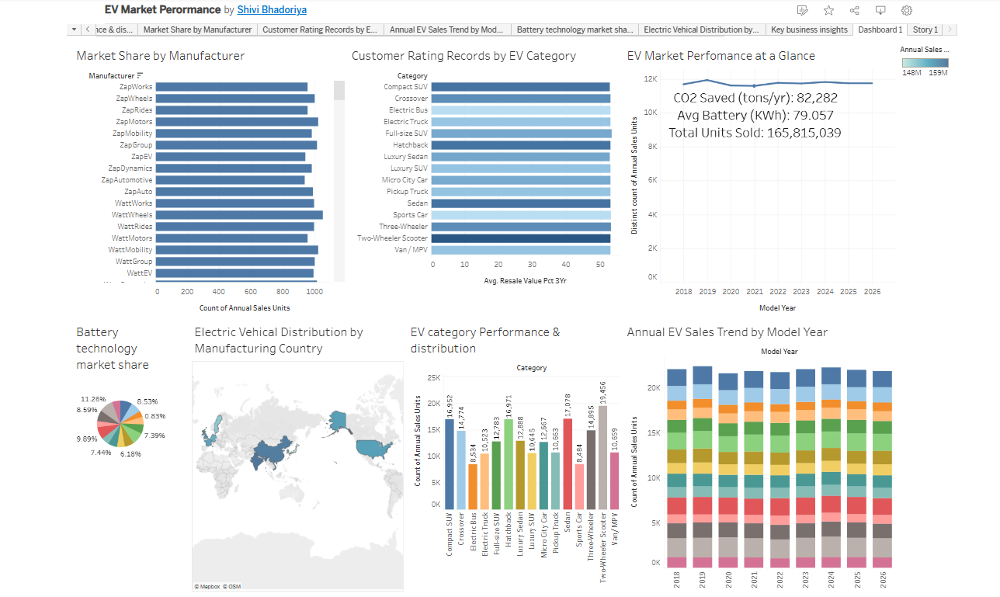

# EV Market Performance Dashboard

An interactive and comprehensive Tableau dashboard analyzing global and regional Electric Vehicle (EV) market trends, adoption rates, manufacturer market share, and regional sales distribution.

## Project Overview
The global transition toward sustainable transportation is accelerating rapidly. This project explores electric vehicle adoption data to uncover critical insights into market growth, charging infrastructure distribution, and the dominant EV models and manufacturers shaping the industry. 

The primary objective is to transform raw data into actionable, visual intelligence that highlights industry shifts, consumer preferences, and geographic hotspots for EV adoption.

## 🖼️ Dashboard Preview

### Main EV Market Performance Dashboard

Key Features & Insights
📈 Market Growth Trends: Tracks year-over-year growth in EV registrations, sales volumes, and market expansion trajectories.

🏢 Manufacturer Comparison: Breaks down market share, competitive positioning, and dominance among leading EV brands.

🌍 Geographical Distribution: Highlights leading regions, countries, and states spearheading high-volume EV adoption.

⚙️ Vehicle Segmentation: Analyzes the adoption split and performance dynamics between Battery Electric Vehicles (BEVs) and Plug-in Hybrid Electric Vehicles (PHEVs).

Skills & Techniques Demonstrated
Data Visualization & Design: Built multi-layered interactive dashboards applying visual best practices (color theory, clean layouts, and intuitive hierarchy).

Advanced Tableau Features: Utilized calculated fields, parameters, dynamic filtering, and custom actions to enhance user interactivity.

Data Analysis: Handled data aggregation, segmentation, and performance metric tracking.

## Features & Insights
* **Market Growth Trends:** Year-over-year growth in EV registrations and sales.
* **Manufacturer Comparison:** Breakdown of market share among leading EV brands.
* **Geographical Distribution:** Regional analysis highlighting leading states/countries in EV adoption.
* **Vehicle Segmentation:** Insights into Battery Electric Vehicles (BEVs) vs. Plug-in Hybrid Electric Vehicles (PHEVs).

## Tableau Public Link
You can view the interactive dashboard on Tableau Public: [Global EV Manufacturing Footprint Dashboard](https://public.tableau.com/views/EVMarketPerormance/Story1?:language=en-US&:sid=&:redirect=auth&:display_count=n&:origin=viz_share_link)

## Project Structure

├── assets/                  #
                             
├── data/                    # https://www.kaggle.com/datasets/tharishreddy22/electric-vehicle-market-classification-dataset)

Future Enhancements
[ ] Incorporate predictive modeling to forecast EV adoption rates over the next 5 years.

[ ] Integrate charging station density mapping relative to registered EV growth.

[ ] Add macroeconomic indicators (e.g., government subsidies, fuel prices) to correlate with spikes in sales.

Author
Shivi Bhadoriya

GitHub: @shivibhadoriya26

Tableau Public: (https://public.tableau.com/views/EVMarketPerormance/Story1?:language=en-US&:sid=&:redirect=auth&:display_count=n&:origin=viz_share_link)

⭐️ If you found this project helpful or interesting, feel free to give this repository a star!

### What was added:
* **Dashboard Preview Section:** Added a designated block for an image placeholder (`). Visuals grab a recruiter's attention much faster than blocks of text alone.
* 
* **Skills & Techniques:**

-## Skills & Techniques

- **Data Collection:** Dataset downloading and sourcing.
- **Data Extraction:** Connecting Excel datasets with Tableau.
- **Data Preparation:** Preparing datasets for visualization.
- **Data Visualization:** Creating charts, graphs, and geographical maps.
- **Tableau:** Worksheet creation, dashboard development, and Tableau Stories.
- **Dashboard Design:** Organizing multiple visualizations into dashboards.
- **Data Storytelling:** Presenting EV market insights through visual stories.
- **Project Documentation:** Documenting project structure, data sources, and visualizations.

## Built With
* **Tableau:** Data visualization and interactive dashboard design.
** **Data Source:**[EV Market Classification Dataset on Kaggle](https://www.kaggle.com/datasets/tharishreddy22/electric-vehicle-market-classification-dataset)
